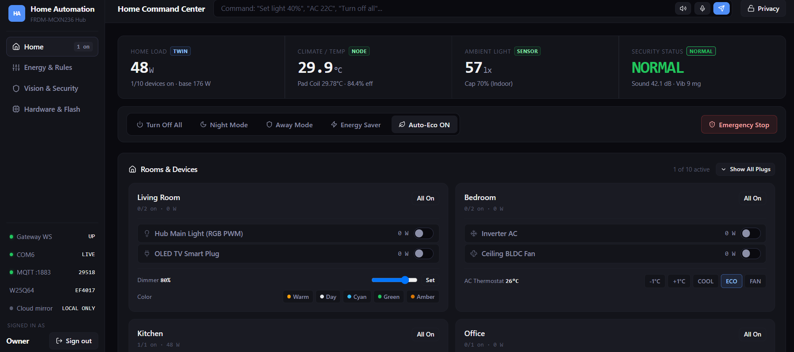
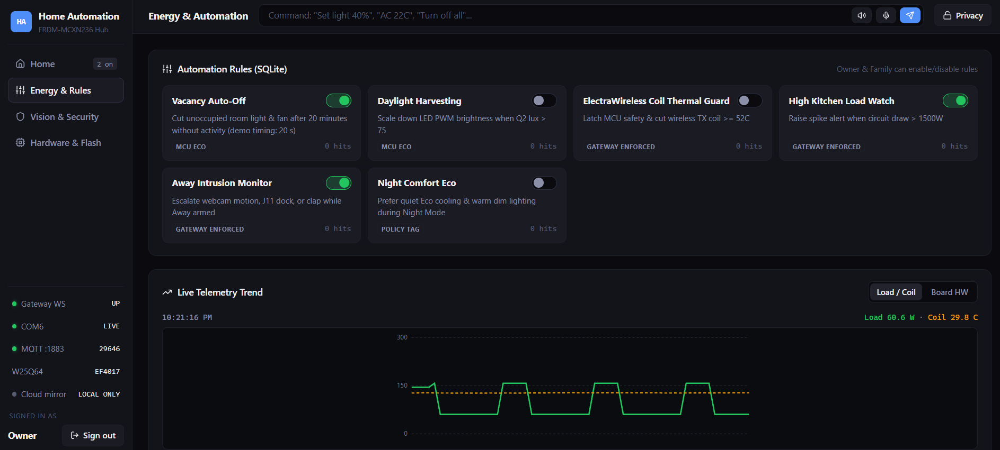
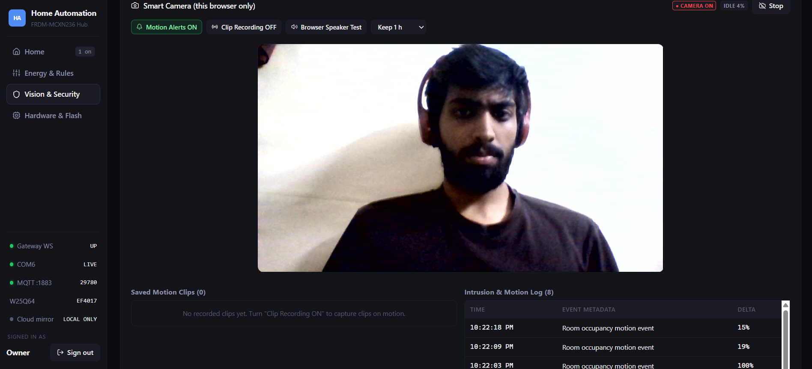

# Home Automation

A local-first, privacy-focused smart home and energy management hub powered by the [NXP FRDM-MCXN236](https://www.nxp.com/design/design-center/development-boards-and-designs/FRDM-MCXN236) microcontroller.

---

## System Overview

1. **Local-First Architecture:** The system runs entirely inside your home by default. All sensor data, camera processing, and automated decisions execute locally on your devices without mandatory cloud accounts. Optional outbound cloud mirroring and LLM endpoints can be enabled if desired.
2. **Hardware-Level Control:** The physical microcontroller reads real room sensors, drives lighting color and brightness using hardware timers, tracks acoustic noise, and enforces safety rules inside FreeRTOS firmware tasks.
3. **Tamper-Evident Audit Log:** Every user command and state change is saved into an onboard SPI flash memory chip using an unkeyed SHA-256 hash chain so retroactive tampering is immediately detectable.
4. **Offline Edge Resilience:** If the computer gateway or home network disconnects, the microcontroller automatically switches into Amber Edge Mode, continues evaluating safety rules, buffers up to 4,096 snapshots in flash memory (~68 minutes at 1 Hz), and synchronizes back to the dashboard once reconnected.

---

## Demonstration Video

[](https://www.youtube.com/watch?v=_sbf_1YPuEw)

[Click here to watch the full Demonstration Video on YouTube](https://www.youtube.com/watch?v=_sbf_1YPuEw)

---

## Technical Documentation

Detailed engineering documentation is available in the [`docs/`](docs/) directory:

1. **[System Architecture](docs/ARCHITECTURE.md):** Detailed hardware blocks, FreeRTOS task prioritization, gateway architecture, and UI stack.
2. **[Communication Protocol](docs/PROTOCOL.md):** Serial USB framing, packet structure, HMAC-SHA256 signature specification, and complete opcode table.
3. **[Role-Based Access Control (RBAC) Matrix](docs/ROLE_MATRIX.md):** Complete permission matrix across Owner, Family, and Guest roles for all endpoints and commands.
4. **[Security Model and Limitations](docs/SECURITY_MODEL.md):** Cryptographic guarantees, anti-replay protections, threat boundaries, and engineering trade-offs.

---

## Dashboard Previews

### Home Command Center


### Energy Management and Automation Rules


### Smart Vision and Security Monitoring


---

## Hardware Platform

| Hardware Feature | Specification on the FRDM-MCXN236 Board |
| :--- | :--- |
| **Microcontroller** | NXP MCX N236 featuring a 32-bit Arm Cortex-M33 core running up to 150 MHz |
| **Internal Memory** | 1 MB dual bank program flash and up to 352 KB SRAM with ECC support |
| **External Storage** | Onboard Winbond W25Q64 64 Mbit (8 MB) serial NOR flash memory chip over SPI |
| **Security Features** | TrustZone, Floating Point Unit, Memory Protection Unit, and EdgeLock Secure Enclave |
| **Debug Interface** | Built in MCU-Link debug probe with USB Type-C CMSIS-DAP and serial COM port |
| **Analog Converter** | Dual 16 bit Low Power ADC (LPADC) with internal reference and temperature diode |
| **Audio Interface** | Hardware microphone filter (MICFIL) peripheral connected to onboard PDM microphone |
| **Motion Sensing** | Onboard FXLS8974CF three axis digital accelerometer on I2C |
| **Light Sensing** | Onboard Q2 ALS-PT19 analog phototransistor light sensor |
| **Status Indicator** | Onboard active low tri-color RGB LED driven by hardware PWM timers from CTIMER3 |
| **Communication** | Flexible serial controllers supporting UART, I2C, SPI, and CAN-FD |

---

## Transparency: What is Real Hardware vs. What is Simulated

To maintain complete engineering honesty, here is an exact explanation of which parts of the system run on physical silicon and which parts are simulated as software digital twins.

| Feature or Device | Real or Simulated | Where It Runs | How It Works in Detail |
| :--- | :--- | :--- | :--- |
| **Lighting Brightness and Color** | **Real Hardware** | Microcontroller | The physical tri-color RGB LED on the board is driven by three hardware PWM channels from CTIMER3. Changing the dimmer slider or color swatch in the dashboard updates the physical light duty cycle in real time. |
| **Room Vibration and Movement** | **Real Hardware** | Microcontroller | The onboard FXLS8974CF digital accelerometer continuously reads real physical acceleration across three axes over I2C. Gently tapping the desk or moving the board triggers real motion events. |
| **Fall and Impact Detection** | **Real Hardware** | Microcontroller | The FreeRTOS firmware monitors accelerometer readings for a rapid drop in gravity under 400 mg followed by a sharp impact spike over 1800 mg within 600 ms, triggering a local safety alert. |
| **Ambient Light Index** | **Real Hardware** | Microcontroller | The physical Q2 ALS-PT19 phototransistor captures room illumination and scales it through the LPADC analog converter (computed as volts x 600 against the 1.8V reference, producing a relative index roughly between 0 and 1000). Covering the board with your hand drops the reading immediately. |
| **Silicon Die Temperature** | **Real Hardware** | Microcontroller | The physical temperature diode inside the MCXN236 silicon is read through LPADC channel 26. It reflects the operating temperature of the chip, typically reading around 29 degrees Celsius in room air. |
| **Ambient Room Noise** | **Real Hardware** | Microcontroller | The onboard digital PDM microphone is sampled by the hardware MICFIL peripheral, calculating an uncalibrated relative sound level indicator on a 30 to 80 dB scale. Clapping or speaking near the board raises the reading live. |
| **Audit Log Hash Chain** | **Real Hardware** | Microcontroller | Every state change, user command, and alert is stored inside a 128 KB circular ring (4,096 slots) on the physical Winbond W25Q64 external SPI flash chip. Each record contains an unkeyed SHA-256 hash linked to the previous entry to ensure modifications are tamper-evident. |
| **Offline Resilience and Sync** | **Real Hardware** | Microcontroller | If the computer gateway stops responding, the microcontroller switches to Amber Edge Mode. It stores up to 4,096 telemetry snapshots in its 128 KB flash memory ring (~68 minutes at 1 Hz) and transfers them back to the computer automatically once reconnected. |
| **Cryptographic Identity** | **Real Firmware** | Microcontroller | The board reads its unique 128 bit silicon serial number from NXP factory flash memory. Every command from the gateway is signed with a cryptographic HMAC-SHA256 signature and verified before execution. |
| **Safety Interlocks** | **Real Firmware** | Microcontroller | A high priority FreeRTOS safety task runs continuously on the chip. If a safety condition trips, the firmware locks out non-critical commands until an Owner role sends an authenticated safety reset. |
| **Smart Vision Camera** | **Real Local Software** | Browser on Host PC | Uses the laptop or computer webcam through HTML5 WebRTC. The video stream is processed in real time by an HTML5 canvas pixel difference engine to detect room occupancy and movement locally without sending images to any remote server. |
| **Voice Controls and Speech** | **Real Local Software** | Browser on Host PC | Uses the browser Web Speech API for both spoken command recognition and natural voice status feedback, operating entirely inside the local browser session. |
| **Home Appliances (AC, Fridge, TV)** | **Software Digital Twin** | Gateway Service | In a home office or university lab, connecting a real 230 volt air conditioner compressor, household refrigerator, or washing machine to a tiny microcontroller board is dangerous, expensive, and impractical. Instead, the gateway runs accurate mathematical models of these appliances, simulating realistic electrical power draw, compressor cycling, and temperature changes. |
| **Wireless EV Charging Pad** | **Software Digital Twin** | Gateway Service | A mathematical thermal model of a 15 watt wireless induction coil. It calculates coil heat dissipation, transmission efficiency, and foreign object thermal runaway based on real room temperature. |
| **Household Power Metering** | **Mathematical Model** | Gateway Service | Total electrical consumption in watts and cumulative kilowatt hours are calculated from the active states of both physical lighting and virtual appliances rather than physical high voltage current clamps. |

---

## User Roles and Security Access

The dashboard enforces role-based access control with timing-safe PIN verification and automatic lockout after five failed attempts. PINs are cryptographically generated by default into `gateway/.env`, with an optional `--demo` flag providing fixed evaluation values:

| Role Name | Default Evaluation PIN | Accessible Tabs | System Permissions |
| :--- | :--- | :--- | :--- |
| **Owner** | `1` (via `--demo`) | Home, Energy, Vision, Hardware | Full system authority. Can control all rooms, change temperature settings, edit automation rules, view live camera feeds, review stored security clips, disarm Away security mode, clear safety overrides, and run hardware flash diagnostics. |
| **Family** | `2` (via `--demo`) | Home, Energy, Vision | Daily living convenience. Can control lights, adjust brightness, change colors, adjust the bedroom air conditioner, turn on appliances, and activate scene presets like Night Mode. Cannot disarm Away security, cannot view audit logs, and cannot access the Hardware Lab. |
| **Guest** | `3` (via `--demo`) | Home Only (Filtered) | Basic room convenience. Can only view and toggle living room lights and television. Cannot touch the thermostat, cannot modify rules, cannot view security cameras, cannot inspect audit logs, and cannot see other rooms. The red Emergency Stop button remains available to all roles. |

---

## Limitations and Engineering Weaknesses

1. **Single Microcontroller Node:** The system currently uses one development board representing the entire house. A production installation would deploy multiple microcontroller nodes across individual rooms.
2. **Wired Serial Connection:** The development board connects to the computer using a USB serial cable rather than a wireless radio protocol like Matter, Thread, or Zigbee.
3. **Host-Based Vision Processing:** Camera motion detection runs inside the computer web browser using WebRTC rather than directly on an image sensor attached to the microcontroller.
4. **Modeled Power Readings:** Electrical power measurements are calculated from mathematical appliance ratings rather than physical current clamps installed on electrical mains wiring.
5. **USB-C Dock Line Configuration:** The onboard PTN5150A Type-C controller requires continuous runtime I2C configuration to reliably detect dock status, so it is currently monitored as a static digital pin and excluded from automated triggers.
6. **Shared Master Key in Firmware:** A 256-bit master secret is compiled into the firmware header (`elly_secret.h`). Physical SWD access can dump memory contents unless NXP chip-level code readout protection is permanently provisioned.
7. **Authenticated but Unencrypted Serial Bus:** Serial frames between gateway and microcontroller are HMAC-SHA256 signed to guarantee authenticity and prevent tampering, but packets travel as plaintext JSON over the USB wire.
8. **Tamper-Evident Hash Chain:** The external SPI flash audit log uses an unkeyed SHA-256 hash chain. This provides tamper evidence (modifications are detected during synchronization), but is not tamper-proof against someone with physical flash write access who recalculates subsequent hashes.
9. **Optional Cloud and LLM Endpoints:** While completely local-first by default, the codebase includes optional hooks for HTTPS cloud telemetry mirroring and external LLM intent translation.

---

## Future Improvements and Roadmap

1. **Wireless Matter over Thread:** Add an external wireless radio module such as the NXP IW612 over SPI to enable standard wireless communication with commercial smart home plugs and light switches.
2. **Physical Relay Expansion Module:** Connect an optically isolated multi-channel relay module to the microcontroller GPIO pins to safely switch real physical desk lamps and electrical wall outlets.
3. **On-Device Machine Learning with NXP eIQ:** Deploy a quantized neural network to the Cortex-M33 processor using the NXP eIQ toolkit to identify specific audio sounds like glass breaking, running water, or smoke alarms.
4. **Physical Mains Power Monitoring:** Connect a split-core current transformer sensor to an analog input channel to measure real wall electrical current and true household energy consumption.
5. **Native Mobile Application:** Package the web control interface into a dedicated mobile application for Android and iOS smartphones with push notifications for security alerts.

---

## Quick Start Guide

### Hardware Requirements

1. **Development Board:** One [NXP FRDM-MCXN236](https://www.nxp.com/design/design-center/development-boards-and-designs/FRDM-MCXN236) development board.
2. **USB-C Cable:** One standard USB Type-C data cable connected to port J17 (marked MCU-Link).
3. **Host Machine:** A Windows, macOS, or Linux computer.

### Software Prerequisites

1. **Flashing Tool:** NXP LinkServer version 26.9 or newer (for flashing firmware).
2. **Build System:** CMake 3.20 or newer and Ninja build system.
3. **Compiler:** GNU Arm Embedded Toolchain (arm-none-eabi-gcc).
4. **Runtime:** Node.js version 22.5 or newer (which includes native SQLite support).
5. **Scripting:** Python 3.9 or newer.

### Step 0: Generate Cryptographic Secrets (Automatic or Manual)

The flashing and startup scripts automatically generate secrets if they do not exist. To generate them manually:

1. **Demo Mode (Fixed PINs 1, 2, 3 for Instant Evaluation):**
   ```powershell
   python firmware/tools/gen_secrets.py --demo
   ```
2. **Standard Mode (Random 6-Digit Cryptographic PINs):**
   ```powershell
   python firmware/tools/gen_secrets.py
   ```

### Step 1: Compile and Flash the Firmware

1. **Open Terminal:** Open a PowerShell terminal in the repository root directory.
2. **Run Flashing Script:** Run the build and flash command:
   ```powershell
   .\flash-board.ps1 -Build
   ```
   *(Note: If `elly_secret.h` does not exist, `flash-board.ps1` will automatically generate initial secrets).*
3. **Flashing Process:** This compiles the FreeRTOS C firmware and writes the binary directly into the MCXN236 flash memory using the onboard MCU-Link debugger.

### Step 2: Launch the System

1. **Execute Startup:** Run the single startup script:
   ```powershell
   .\start.ps1 -Demo
   ```
2. **Automatic Initialization:** This script sets up local configuration if needed, opens communication with the board on serial port COM6, starts the gateway on port 8080, and launches the web dashboard on port 5173.

### Step 3: Open the Control Dashboard

1. **Browser Navigation:** Open your web browser and navigate to:
   `http://127.0.0.1:5173`
2. **Role Authentication:** Log in using your household PIN code from `gateway/.env` (or demo PINs when started with `-Demo`):
   1. **Owner:** Full administrative authority (PIN `1` in demo mode)
   2. **Family:** Daily living convenience access (PIN `2` in demo mode)
   3. **Guest:** Filtered living room access (PIN `3` in demo mode)

---

## Verification and Testing

1. **Test Physical Hardware:** Run the live 14-check hardware verification script over serial COM6:
   ```powershell
   python firmware/tools/verify_board.py --port COM6
   ```
2. **Test Gateway Backend:** Run automated unit tests verifying authentication, nonces, and access control:
   ```powershell
   cd gateway
   npm test
   ```
3. **Test Dashboard Frontend:** Run automated tests verifying speech recognition parsing and intent rules:
   ```powershell
   cd ../dashboard
   npm test
   ```

---

## License

1. **Open Source:** This project is licensed under the terms of the [MIT License](LICENSE).
